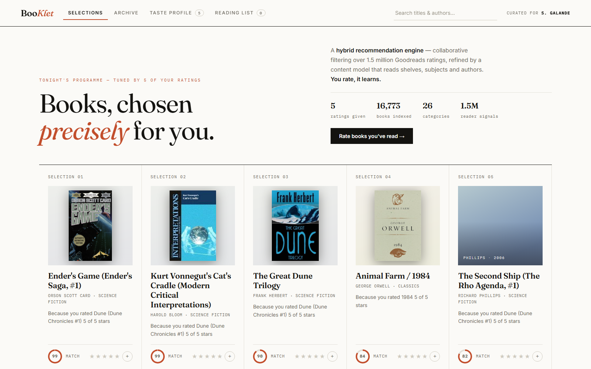

# BooKlet 📚



*Books, chosen precisely for you.* A hybrid book recommendation web app with a
quiet, editorial UI. Rate books you've read → receive numbered "selections"
with reasons, match rings, category & era filters, a taste profile with genre
affinities, and a reading list.

**Stack:** Python · Flask · Pandas · scikit-learn · vanilla JS (no build step)

## The catalogue

Two sources, so the shelves are both deep and current:

| Source | What it brings |
|---|---|
| **goodbooks-10k** | 10,000 Goodreads books and ~6M ratings — the collaborative signal (readers who liked X also liked Y) |
| **Open Library subjects** | Hundreds more titles per category, with covers — contemporary, technical and non-Western books the 2017 Goodreads dump never had |

Every book is filed into **26 categories** — from Fantasy and Classics through
Technology & Coding, Business & Economics, Self-Help & Habits, Psychology and
Indian Writing.

Categories aren't guessed from one keyword. Each goodbooks title is scored
against every category using its **weighted reader-shelf counts** (an exact
shelf match counts triple), then keeps the categories that clear 28% of its
top score. That's why *1984* files under Science Fiction and Classics rather
than whichever keyword happened to match first.

## How the engine works

| Model | Technique | Weight |
|---|---|---|
| Collaborative | Item-item cosine similarity over mean-centered reader ratings (sparse matrix) | 0.9 |
| Content-based | TF-IDF over shelf tags, subjects, category and author | 0.1 |

At request time the engine walks the neighbours of everything you rated,
weights by how far each verdict sits from neutral, blends a Bayesian
popularity prior that fades as your profile grows, and returns ranked
selections — each explained by the rated book that contributed most.

Collaborative neighbours exist for the goodbooks half (that's where the
ratings are); the content model covers the whole catalogue, so supplemental
titles are still recommendable and searchable.

## Cover art

Every book ships its own jacket — no API key needed:

1. `prepare_data.py` keeps the **Goodreads cover URL** and ISBN-13 for
   goodbooks titles, and an **Open Library cover id** for supplemental ones.
2. Goodreads has no jacket for a slice of its own catalogue, so the build
   asks **Open Library's books API by ISBN** — batched 40 at a time — to fill
   those gaps, cached in `data/raw/isbn_covers.json`.
3. The frontend requests the 300px edition, retries once if a burst gets
   throttled, then falls back to the thumbnail and to Open Library by ISBN.
4. If all miss, the card keeps its category-tinted paper mat with the author
   and year set on it — nothing ever renders broken.

Covers are drawn *contained* on the mat rather than cropped to fill it, so a
portrait jacket is never sliced to fit a landscape frame.

## Evaluation

`python evaluate.py` holds out one random ≥4★ rating per reader (600 readers),
rebuilds the collaborative model without it, and checks whether the held-out
book is in the top 10 of the whole catalogue:

| Model | HR@10 | NDCG@10 | Coverage |
|---|---|---|---|
| Popularity only | 0.007 | 0.003 | 0.1% |
| Content only | 0.073 | 0.040 | 8.4% |
| Collaborative only | 0.182 | 0.120 | 10.9% |
| Hybrid 0.6 / 0.4 (old weights) | 0.117 | 0.072 | 9.6% |
| **Hybrid 0.9 / 0.1 (shipped)** | 0.180 | 0.118 | 11.9% |

Re-weighting toward the collaborative signal lifted hit rate by ~54% over the
original blend. Supplemental Open Library titles have no reader ratings, so
they surface mainly through category shelves and search.

## Run locally

```bash
pip install -r requirements.txt
python prepare_data.py   # first run: downloads goodbooks-10k (~90 MB) + fetches Open Library (~2 min)
python app.py            # dev server  -> http://127.0.0.1:5211
python serve.py          # prod server (waitress)
```

The Open Library fetch is cached to `data/raw/openlibrary.json`, so later
rebuilds take seconds.

## Host it with Docker

```bash
docker compose up -d --build     # http://127.0.0.1:8087, container "booklet" on web_proxy
```

Point the tunnel route at `http://booklet:8000`. Health check: `GET /healthz`.
The image ships the prebuilt `data/*.json` (no 90 MB download at build time).

## Host it (Render / Railway / PythonAnywhere)

1. Push this folder to a GitHub repo.
2. Build command: `pip install -r requirements.txt && python prepare_data.py`
3. Start command: `gunicorn app:app` (Linux hosts) or `python serve.py`.
4. Stateless backend — ratings live in the browser, so any free tier works.

Append `?demo=1` to the URL to seed a sample taste profile — handy for a link
on a résumé, so visitors land on a populated app. You can also deep-link a
view: `?demo=1&view=archive&category=Technology%20%26%20Coding`.

The Open Library caches (`data/raw/openlibrary.json`, `isbn_covers.json`) are
committed deliberately — without them a deploy would re-crawl the API on every
build.

## API

| Endpoint | Description |
|---|---|
| `GET /api/init` | Catalogue stats, categories, eras, onboarding + popular books |
| `POST /api/recommend` | `{ratings:{id:stars}, shelf?, era?, n?}` → ranked selections with reasons |
| `GET /api/similar/<id>` | Blended nearest neighbours of one book |
| `GET /api/search?q=` | Title & author search |

---
Built by **Samarth Galande** — B.Sc Data Science & AI.
